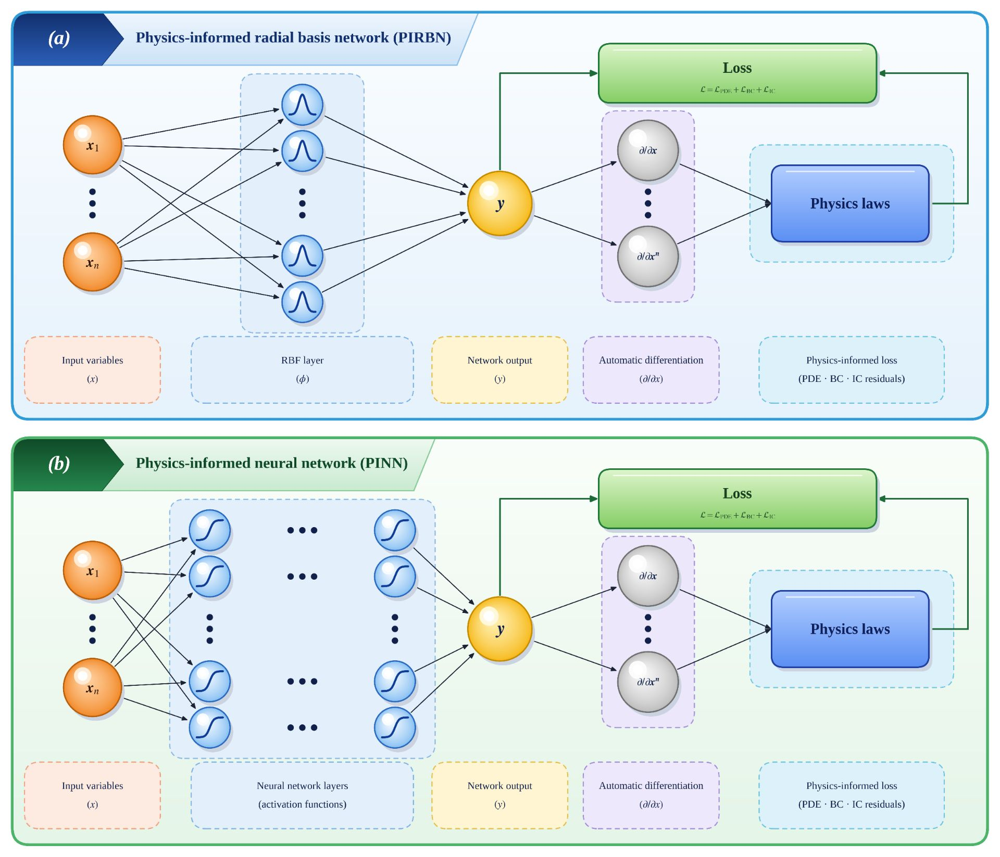

# RBF-fPINN vs MLP-fPINN: a statistically controlled comparison

Code for a controlled comparison of a radial-basis-function-based fractional PINN (**RBF-fPINN**)
and a multilayer-perceptron-based one (**MLP-fPINN**) on time-fractional diffusion problems with
the L1 discretization of the Caputo derivative. Both networks are trained with the same schedule
(5000 Adam iterations, then full-batch L-BFGS with at most 20,000 iterations). The Example 4.2
scripts compare them with seed-paired Wilcoxon signed-rank tests (Holm correction in Stage 3); the
Example 4.1 scripts record the errors of every run in CSV files.

<p align="center">
  
</p>
<p align="center"><em>The two architectures compared in this repository: (a) RBF-based and (b) MLP-based physics-informed networks. Both map the inputs to the solution, obtain the derivatives by automatic differentiation and are trained on the same physics-informed loss.</em></p>

| Example | Problem | Localized feature | Varied quantity |
|---------|---------|-------------------|-----------------|
| 4.1 (1D) | `u = (1 + t^3) exp(-mu (x - 0.5)^2)` on `[0,1]^2` | narrow spatial peak | width parameter `mu` |
| 4.2 (2D) | `u = (1 + t^(2-alpha)/Gamma(3-alpha)) sin(pi x) sin(pi y)` on irregular domains (butterfly, pentagram) | initial temporal layer | fractional order `alpha` |

The study is organised in stages: reproduction with several seeds (Stage 0), fair tuning of the MLP
(Stage 1), budget-matched comparison with equal parameters or equal training time (Stage 2) and, for
Example 4.2, a 10-seed confirmation at the reference setting (Stage 3, `k = 1`).

## Repository structure

```
.
├── example_4_1_1D/
│   ├── 00_reference_single_run.py         # reference implementation (single run, seed 1234)
│   ├── 01_stage0_baseline_replication.py  # Stage 0: multi-seed replication
│   ├── 02_stage1_mlp_tuning.py            # Stage 1: fair MLP tuning (32 configurations)
│   ├── 03_stage2A_parameter_matched.py    # Stage 2, Scenario A: equal parameters
│   └── 04_stage2B_time_matched.py         # Stage 2, Scenario B: equal training time
├── example_4_2_2D/
│   ├── 00_stage0_reproduction.py          # Stage 0: reproduction (3 kernels, 3 alpha, 4 N, 2 samplers)
│   ├── 01_stage1_mlp_tuning.py            # Stage 1: fair MLP tuning
│   ├── 02_stage2_budget_matched.py        # Stage 2: equal parameters (A) and equal time (B)
│   └── 03_stage3_confirmation_k1.py       # Stage 3: 10-seed confirmation at the reference setting
├── docs/
│   └── architecture.png                   # figure used in this README
├── requirements.txt
└── LICENSE
```

## Installation

```bash
pip install -r requirements.txt
```

The code uses plain PyTorch (no DeepXDE). A CUDA GPU is strongly recommended; all experiments were
run on Kaggle with two NVIDIA T4 GPUs.

## Usage

### Example 4.1 (1D)

Each script is self-contained and resumable. Results are written to CSV files in the working
directory, and rows that already exist are skipped when a script is started again.

```bash
python example_4_1_1D/01_stage0_baseline_replication.py
python example_4_1_1D/02_stage1_mlp_tuning.py
python example_4_1_1D/03_stage2A_parameter_matched.py
python example_4_1_1D/04_stage2B_time_matched.py
```

Stages 2A and 2B can also resume from a CSV checkpoint of an earlier session: set `PREV_RESULTS_DIR`
to the folder that contains it (default: `/kaggle/input`).

### Example 4.2 (2D)

The four stages are run in order. Every script launches one worker per GPU, writes its results
incrementally to `results/` and can be restarted: finished runs are skipped. Tables and statistical tests
are written to `figures/`.

```bash
python example_4_2_2D/00_stage0_reproduction.py all
python example_4_2_2D/01_stage1_mlp_tuning.py all
python example_4_2_2D/02_stage2_budget_matched.py all
python example_4_2_2D/03_stage3_confirmation_k1.py all
```

Later stages reuse the runs of earlier ones (the MLP runs of Stage 1 are needed by Stage 2, and the
first five seeds of Stage 3 repeat Stage 0/1 configurations). Point `PREV_RESULTS_DIR` to the folder
that contains the `runs_w*.jsonl` files of the earlier stages (default: `/kaggle/input`):

```bash
PREV_RESULTS_DIR=/path/to/previous/results python example_4_2_2D/02_stage2_budget_matched.py all
```

Default settings (seeds, time budget `hours`) are defined at the top of each script and can be
overridden with a `settings.json` file in the working directory.

## Reproducibility

- **Seeds:** a seed fixes the initialization and the training points, so all RBF/MLP comparisons are
  paired.
  - Example 4.1: the reference run uses seed `1234`; Stage 0 uses seeds `0`-`9`; Stages 1-2 use a
    pre-registered pool of 10 seeds generated from the master seed `20250826`
    (`908174675`, `2021242550`, `1298657243`, `2554806439`, `3639288809`, `1404135774`,
    `1953773272`, `886292835`, `2767164605`, `3922647745`).
  - Example 4.2: a pre-registered pool of 10 seeds (`1234`, `3154326823`, `3750868552`, `243740839`,
    `3730658245`, `3471616824`, `1792976967`, `2616433539`, `2214267315`, `3377612822`).
- **Number of runs (Example 4.2):** Stage 0: 420 + 81 (protocol ablation); Stage 1: 354;
  Stage 2: 75; Stage 3: 40.
- **Point sets (Example 4.2):** 150 interior and 50 boundary training points per time level; the MLP is selected on
  a validation set disjoint from the test set, and restarts (Stage 2, Scenario B) are selected on the
  training loss only.
- **Precision:** single precision (`float32`).
- **Self-checks:** every 2D stage verifies the source term, the L1 matrix and the point counts and runs
  a smoke test before the full run starts.

## License

Released under the MIT License. See [LICENSE](LICENSE).
